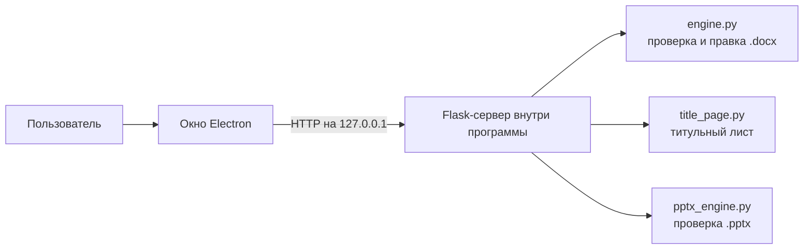

<div align="center">


<br>

**Настольная программа, которая сама приводит школьные и студенческие работы в Word к нужному оформлению.**

[](https://github.com/RAMPAAAGE/oformitel/releases/latest/download/Oformitel-Setup.exe)
[](https://github.com/RAMPAAAGE/oformitel/releases/latest/download/Oformitel-mac.dmg)

[](https://github.com/RAMPAAAGE/oformitel/releases/latest)
[](https://github.com/RAMPAAAGE/oformitel/actions)


</div>

---

## Зачем это нужно

Каждый, кто сдавал реферат или исследовательскую работу, знает, сколько времени уходит на оформление. Нужно выставить поля, шрифт и интервалы, проставить нумерацию страниц, поставить точки в оглавлении и сделать титульный лист. Оформитель делает это сам: выбираешь файл `.docx` и профиль оформления, нажимаешь одну кнопку и получаешь готовый документ.

## Возможности

| | Что умеет |
|---|---|
| 📄 **Оформление документа** | Проверяет и исправляет поля, шрифт, размер шрифта, межстрочный интервал и отступ первой строки |
| 🔢 **Структура** | Расставляет номера страниц, точки в оглавлении и подписи к рисункам, начинает каждую главу с новой страницы |
| ✍️ **Пунктуация** | Находит частые ошибки в запятых и сокращениях и показывает список исправлений |
| 🏷️ **Титульный лист** | Собирает титульный лист с нуля по заполненным полям и может вставить его в начало работы |
| 📊 **Проверка презентаций** | Проверяет `.pptx` и находит точки в конце заголовков и слишком длинный текст на слайдах |
| ⚙️ **Свои профили** | Готовые профили «ГОСТ 7.32-2017» и «Инженеры будущего», можно создать и свой |

Если документ уже оформлен правильно, программа его не трогает и так и пишет.

## Установка

### Windows
1. Нажми кнопку **«Скачать — Windows»** выше.
2. Запусти `Oformitel-Setup.exe`, и программа установится сама.
3. Если Windows покажет окно «Система Windows защитила ваш компьютер», нажми **«Подробнее» → «Выполнить в любом случае»**. Это предупреждение появляется у всех программ без платной цифровой подписи.

### macOS (Apple Silicon: M1, M2, M3…)
1. Нажми кнопку **«Скачать — macOS»** выше.
2. Открой `Oformitel-mac.dmg` и перетащи приложение в папку «Программы».
3. При первом запуске macOS может не дать открыть приложение. Тогда открой **Системные настройки → Конфиденциальность и безопасность** и нажми **«Всё равно открыть»**.

Python и другие программы ставить не нужно: всё уже внутри.

## Как пользоваться

**Вкладка «Документ»**: выбери `.docx`, выбери профиль, отметь нужные исправления и нажми «Оформить документ».

**Вкладка «Титульный лист»**: заполни учебное заведение, название работы, участников, руководителя, город и год. Программа соберёт готовый `.docx`.

**Вкладка «Презентация»**: выбери `.pptx` и получи список замечаний по номерам слайдов.

## Как это устроено



- **Electron** показывает окно программы.
- **Flask** работает только внутри программы, наружу он не виден. Браузер пользователю не нужен.
- **python-docx** и **python-pptx** читают и меняют файлы Word и PowerPoint.
- **PyInstaller** упаковывает Python-часть в один файл, поэтому на компьютере пользователя Python не нужен.
- **GitHub Actions** сам собирает версии для Windows и macOS при каждом новом релизе.

<details>
<summary><b>Для разработчиков: запуск из исходников, тесты, сборка</b></summary>

### Что нужно
- Python 3.10 или новее
- Node.js 20 или новее
- Docker Desktop (необязательно, только для запуска backend в контейнере)

### Запуск backend отдельно

```bash
cd oformitel/backend
python3 -m venv .venv
source .venv/bin/activate          # Windows: .venv\Scripts\activate
pip install -r requirements.txt
python3 app.py
```

Затем открой `http://127.0.0.1:5000`.

### Запуск настольного приложения

```bash
cd oformitel/backend
source .venv/bin/activate          # Windows: .venv\Scripts\activate
cd ../electron
npm install
npm start
```

Electron сам запустит Flask, отдельно запускать `app.py` не нужно.

### Docker

```bash
docker compose up --build
```

### Тесты

```bash
python3 -m unittest discover -s tests -v
```

### Сборка установщика

```bash
cd oformitel/backend
pip install -r requirements.txt -r requirements-build.txt
cd ../electron
npm install
npm run dist
```

На macOS то же самое делает двойной клик по `Собрать_приложение.command`. Windows-версию собирают на Windows, macOS-версию на Mac.

### Выпуск новой версии

1. Поменяй `version` в `electron/package.json`.
2. Создай тег и отправь его на GitHub:
   ```bash
   git tag v1.0.1
   git push origin v1.0.1
   ```
3. GitHub Actions соберёт оба установщика и сам создаст релиз. Кнопки «Скачать» сразу начнут вести на новую версию.

### Структура проекта

```text
oformitel/
├── backend/
│   ├── app.py            # Flask-сервер: принимает файлы, отдаёт результат
│   ├── engine.py         # проверка и исправление оформления .docx
│   ├── punctuation.py    # поиск ошибок пунктуации
│   ├── title_page.py     # создание титульного листа
│   ├── pptx_engine.py    # проверка презентаций
│   └── profiles/         # профили оформления (JSON)
├── electron/
│   ├── main.js           # запуск окна и backend
│   └── build/            # интерфейс (index.html, style.css) и иконка
├── tests/                # автоматические тесты
└── .github/workflows/    # автосборка релизов
```

</details>

---

<div align="center">

Школьный проект · сделал [RAMPAAAGE](https://github.com/RAMPAAAGE)

</div>
